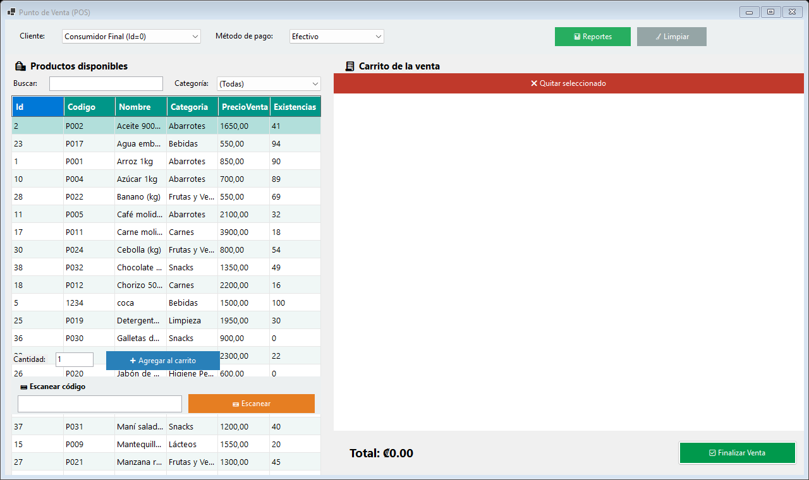
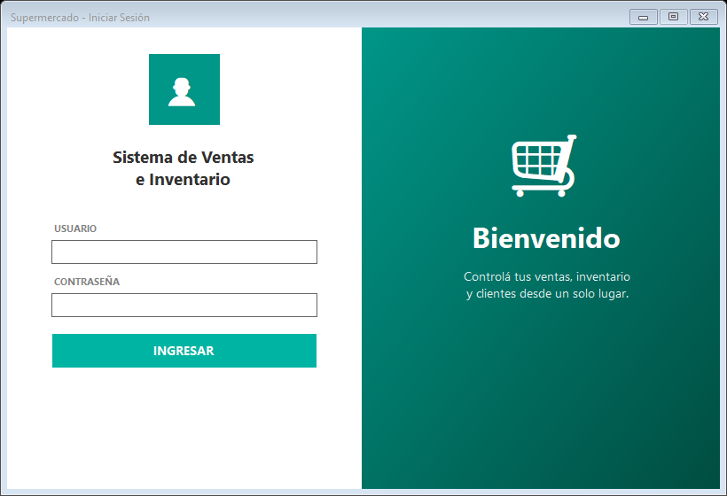
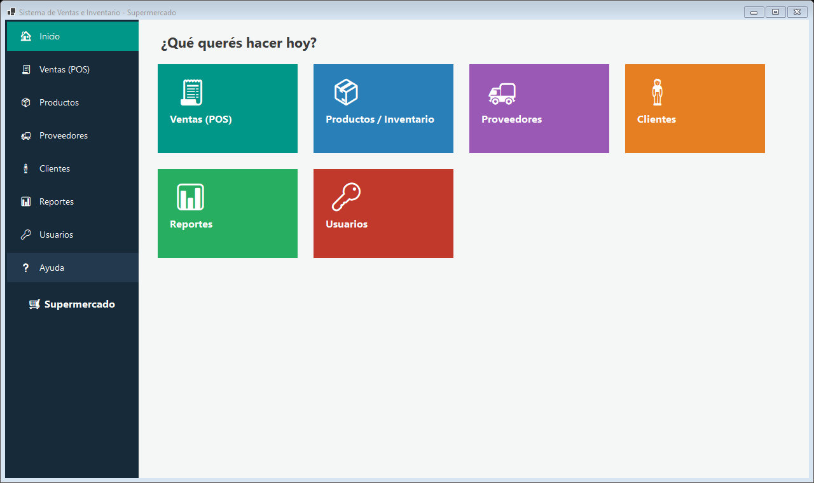
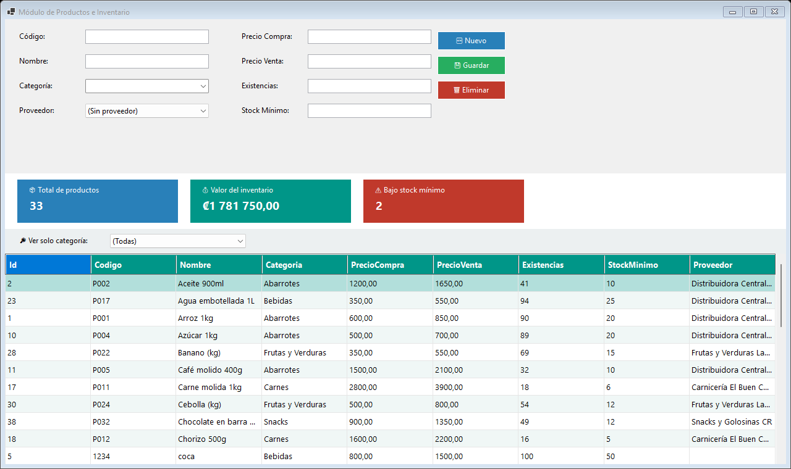
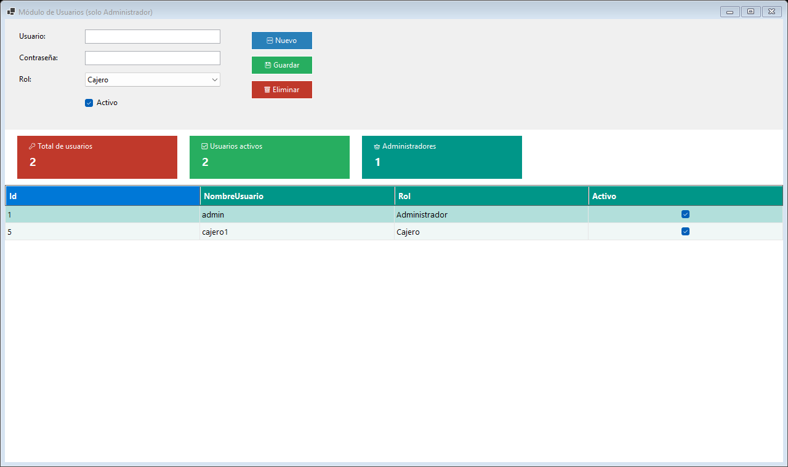

# SupermercadoApp — Sistema de Ventas e Inventario para Supermercado

> **EN:** Desktop point-of-sale and inventory system for a supermarket, built in **C# (Windows Forms)** with **SQL Server**. Includes login with hashed passwords and roles, product/supplier/customer/user management, a point of sale with barcode scanning, low-stock alerts, inventory movement history, an audit log and CSV-exportable reports. Team final project for Systems Analysis and Design I, UACA (Costa Rica), 2026.

Proyecto final en equipo de **Análisis y Diseño de Sistemas I**, Bachillerato en Ingeniería en Sistemas Computacionales, Universidad Autónoma de Centroamérica (UACA).



---

## Funcionalidades

| Módulo | Qué permite |
|---|---|
| **Login y roles** | Contraseñas encriptadas con SHA-256; rol **Administrador** (acceso completo) y **Cajero** (ventas y reportes) |
| **Inicio** | Panel con tarjetas por módulo y aviso automático de productos bajo el stock mínimo |
| **Productos / Inventario** | CRUD con categoría y proveedor en listas desplegables, validación de código duplicado y filtro por categoría |
| **Proveedores y Clientes** | CRUD con buscador rápido y validación de correo, teléfono y cédula |
| **Usuarios** | Mantenimiento de usuarios del sistema (solo Administrador) |
| **Punto de Venta (POS)** | Catálogo visual, buscador con autocompletado, escaneo de código de barras, carrito, control de existencias e impresión de comprobante |
| **Reportes** | Ventas por rango de fechas, bajo stock, productos más vendidos, movimientos de inventario y bitácora, exportables a CSV |
| **Bitácora de auditoría** | Registra quién hizo qué y cuándo (inicio de sesión, cambios en cada módulo, ventas) |

## Capturas de pantalla

| Inicio de sesión | Panel principal |
|---|---|
|  |  |
| **Productos e inventario** | **Usuarios** |
|  |  |

## Tecnologías

- **Lenguaje:** C#
- **Plataforma:** .NET 6, Windows Forms
- **Base de datos:** SQL Server (ADO.NET)
- **IDE:** Visual Studio 2022

## Estructura del proyecto

```
SupermercadoApp/
├── BaseDeDatos.sql            # Crea la base de datos completa con datos de ejemplo
├── ActualizarBaseDatos.sql    # Migración si ya existía la base
├── AgregarMasDatos.sql        # Más proveedores, productos y clientes de ejemplo
├── CorregirStockNegativo.sql  # Corrige existencias negativas antiguas
├── Datos/                     # Conexión, seguridad (hash), sesión y auditoría
├── Modelos/                   # Entidades del sistema
├── Forms/                     # Login, Principal, Productos, Proveedores, Clientes, Usuarios, Ventas, Reportes
└── Program.cs                 # Punto de entrada
```

## Cómo ejecutarlo

1. Tener **SQL Server** (Express sirve) y **Visual Studio 2022** con la carga de trabajo **Desarrollo de escritorio de .NET**.
2. En SQL Server Management Studio, ejecutar `BaseDeDatos.sql` (crea la base, las tablas y datos de ejemplo).
3. En `Datos/Conexion.cs`, cambiar el nombre del servidor por el de tu instancia.
4. Abrir `SupermercadoApp.sln` y presionar **F5**.

### Usuarios de prueba

| Rol | Usuario | Contraseña |
|---|---|---|
| Administrador | `admin` | `admin123` |
| Cajero | `cajero1` | `cajero123` |

Los datos de ejemplo traen proveedores, productos en varias categorías, clientes y ventas, para que los reportes muestren información desde el primer inicio. El producto "Jabón de baño" queda a propósito bajo el mínimo para mostrar la alerta de bajo stock.

## Más detalles

El archivo [LEEME.md](LEEME.md) tiene el registro completo de correcciones y mejoras del proyecto.
